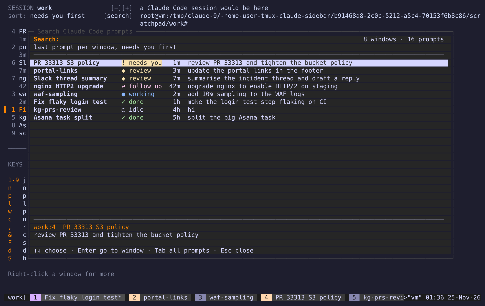
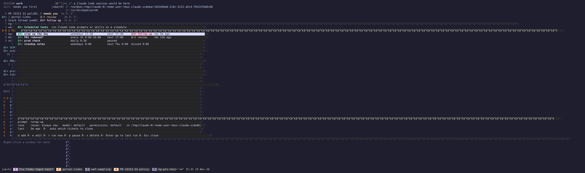
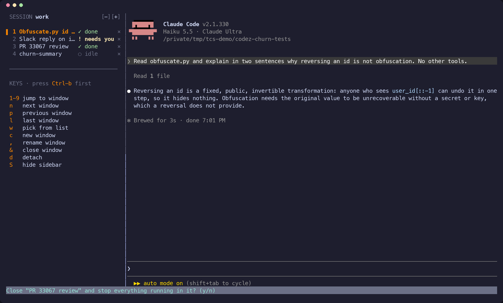

# tmux-claude-sidebar

A window list on the left of every tmux window, for running several Claude Code
sessions side by side (one tmux window per git worktree). Each row shows what
that session is doing, so you can see which one is waiting for you: the ones
that need you are at the top, a finished turn stays yellow until you have
looked at it, and an AI check tells you whether the work is wrapped up or you
should come back to it. Scheduled tasks run a prompt or skill for you on a
cadence ("wrap up the day at 5:30", "are my PRs rebased?").


## What the sidebar shows


From the top:

- **Session name**, and `[−]` `[+]` to make the sidebar narrower or wider.
- **Sort order** (click to switch) and `[search]`.
- **One row per window**: its number, name, Claude Code status, how long
  ago that status changed, and a `×` to close it. The orange bar marks the
  window you are in.
- **Status**:
  - `! needs you` (bold yellow): a permission prompt or a question dialog.
  - `◆ review` (yellow): Claude finished while you were not looking, and
    the work is wrapped up (or the AI check has not answered yet).
  - `↩ follow up` (bold magenta): Claude finished while you were not
    looking, and the turn is not wrapped up: it asked something, offered
    options, hit an error, or left steps undone.
  - `↩ to do` (magenta): a follow-up you have already looked at. It stays in
    the list until you reply or mark it wrapped up, but no longer counts as
    unread.
  - `● working` (blue), `✓ done` (green, wrapped up and seen), `○ idle` (grey).
- **Why a window needs you** (`↩ asks whether to open a PR`) and your last
  prompt are in search (`Ctrl-b F`), which keeps the list itself short.
- **↻ SCHEDULED**: your scheduled tasks, each with its next run, and under
  it the window it last ran in with that run's status (and why, if it needs
  you). Click a task to manage it, a run line to go to that window, or
  `[+ add]` to add one.
- **Keys**: the tmux keys you use most. Click one, or press `Ctrl-b` and
  then the key.

<br clear="right">

## Features

- **Status per window**: `working` after you send a prompt, `needs you` when
  Claude asks for permission or asks you a question, `review` when it
  finishes while you are elsewhere, `done` once you have looked, `idle` when a
  session has started but has no prompt yet (or you stopped it with Esc).
  Windows without Claude Code show no status.
- **Review until you look**: a turn that ends in a window you are not looking
  at shows `◆ review` and turns its tab in the status bar yellow. Switching to
  the window marks it `done`. "Looking" means it is the current window and the
  terminal has focus, so a turn that ends while you are in another app also
  waits for you.
- **Wrapped up, or come back to it?** When a turn ends, a short background
  call to Claude (`claude -p --model haiku`, with your existing login) reads
  your last prompt and Claude's final message and decides. A turn that needs
  you shows `↩ follow up` until you look at it, then `↩ to do`, which stays
  near the top until you send another prompt or right-click it and choose
  "Mark as wrapped up". Before that call answers (a few seconds), a reply that ends with a
  question already counts as a follow-up. It costs one small Haiku request per
  finished turn; turn it off from the right-click menu, or with
  `~/.tmux/sidebar/sidebar.sh judge off`. That call runs with hooks, tools,
  MCP servers and session saving switched off.
- **Sorted by what needs you**: `needs you`, then unread (`review` and
  `follow up`), then `to do`, then the rest by when they last changed, then
  windows without Claude Code.
  Click `sort:` at the top to switch to window-number order (kept after tmux
  restarts). The numbers shown are always the tmux window numbers, so
  `Ctrl-b 3` still goes to window 3.
- **Search every prompt** (`Ctrl-b F`, or click `[search]`): with nothing
  typed it lists each Claude window once with your last prompt, needs-you
  first. Type to search every prompt you have sent in every window, across
  all tmux sessions (from each session's transcript, so older prompts and
  resumed sessions are included). `Enter` goes to that window, `Tab` lists all
  prompts, `Esc` closes.
- **Scheduled tasks** (`Ctrl-b T`, or `[+ add]`): run a prompt or a skill on
  a schedule, like `/loop` but in your own tmux and repos. Examples:
  "wrap up the day" at `weekdays 5:30pm` running `/wrap-up`; "PRs rebased?"
  `every 2h 9am-6pm`; "prod check" `daily 9:30` with "check what I deployed
  yesterday works in prod and tell me if I need to follow up". Schedules can
  be written as `weekdays 5:30pm`, `every 30m`, `every 2h 9am-6pm`,
  `mon,thu 9:00`, `daily 9:30`, `noon` or a cron line; anything else is
  translated by Haiku and shown back to you. A task runs at most every 5
  minutes.
  - **Where a run goes**: the task's previous run window if it is free;
    otherwise Haiku looks at your open Claude windows (name, folder, last
    prompt, outcome) and reuses one only if it has the context the task needs
    (for example the window that did the deploy you want checked); otherwise
    a new window. A window is never used if it is working, needs you, has an
    unread result or a follow-up, is the one you are looking at, or has text
    typed in its input box. Set a task to "always new" for a fresh session
    each run: it then replaces its previous run window once that one is
    finished and read (and keeps it while it is unread or needs you).
  - **What you see**: windows a schedule opened are listed under ↻ SCHEDULED
    rather than with your own windows. A window of yours that a schedule
    reused is marked `↻` until you send it your own next prompt. When a run
    ends, the AI check says whether it is wrapped up; a run that needs a
    follow-up rings the bell, so its tab turns yellow.
  - **What a run is told**: each run's prompt starts with a short note
    that this is one run of an existing schedule, so a prompt written like
    "every hour, check my PRs" does the check instead of setting up its own
    loop or asking about scheduling, and does not stop to ask questions
    while nobody is watching. Skills (`/name`) are sent as they are. The
    note is hidden from the sidebar, search and the AI check.
  - **No repeats**: each run ends with a "Reported:" line, which is kept in
    `~/.tmux/claude-sidebar-notes/`; the next run is shown what was already
    reported, so "don't tell me twice" works. A run that reports nothing new
    and is wrapped up is marked read, so an hourly check only gets your
    attention when it has news.
  - **Unattended, but not unsupervised**: runs use your normal permission
    mode, so a run that wants to do something that needs approval waits at
    `! needs you`. You can set a model and permission mode per task.
  - **Missed runs**: the scheduler runs inside tmux, so nothing runs while
    tmux is not running or the computer sleeps. A run less than 2 hours late
    starts when it can; an older one is skipped and shown as "missed". A run
    that is due while the last one is still working is skipped.
  - **Clean-up**: run windows that are done, have been looked at, are not a
    task's latest run and have not changed for a day are closed.
  - Tasks are kept in `~/.tmux/claude-sidebar-schedules.json` (uninstall
    leaves this file). From a shell: `~/.tmux/sidebar/sched.py add|run|pause|
    resume|delete|list|parse`.
- **Right-click a window row** for a menu: switch to it, mark it reviewed or
  wrapped up (or all reviewed), move it up, down or to the top (this changes
  the tmux window numbers), rename or close it, and turn the AI check on or
  off. Right-click elsewhere still shows tmux's own menu.
- **Click a window row** to switch to it. **Click a key row** to do the same as
  typing `Ctrl-b` and that key. Clicking the sidebar never moves keyboard focus
  into it.
- **Click `×`** to close that window. tmux asks `(y/n)` first, then closes the
  window and stops everything running in it (Claude Code, the shell, and their
  child processes).
- **Width**: 40 columns by default. Click `[−]` or `[+]` at the top of the
  sidebar to make it 2 columns narrower or wider, or drag its right border.
  The new width applies to every window and is kept after tmux restarts
  (it is saved in `~/.tmux/claude-sidebar-width`).
- **`Ctrl-b S`** hides or shows the sidebar in every window of the session. New
  windows follow the current setting.
- **Window names** come from the title Claude Code gives its session, like
  Terminal tabs do. Until Claude sets a title, the window is named after its
  directory, with a leading `codez-` removed. `Ctrl-b ,` renames a window and
  the name then stays fixed.
- A permission prompt in a background window rings the terminal bell, so its
  tab in the status bar turns yellow with a `!`.

`Ctrl-b F` with nothing typed answers "what was I doing in each window?":



`Ctrl-b T` manages scheduled tasks:



Right-click on a window row:


Every default tmux key still works. The only new keys are `Ctrl-b S`,
`Ctrl-b F` and `Ctrl-b T`.

Clicking `×` on the "PR 33067 review" row shows this prompt at the bottom.
`y` closes the window, `n` keeps it:



## Install

Needs macOS or Linux, tmux 3.4 or newer, git, python3, and Claude Code.

```sh
git clone https://github.com/andrsnn/tmux-claude-sidebar.git
cd tmux-claude-sidebar
./install.sh
```

Then start tmux, or if it is already running, `install.sh` reloads it for you.
Restart any Claude Code sessions that were already running, so they load the
new hooks.

Running `./install.sh` again is safe; it replaces what it installed before.

### What install changes

- **Backups first**: `~/.tmux.conf` and `~/.claude/settings.json` are copied to
  `.bak-YYYYMMDD` (with a time added if that name is taken).
- **`~/.tmux/sidebar/`**: the scripts (`render.sh` draws the sidebar,
  `sidebar.sh` handles clicks and tmux hooks, `hook.sh` records Claude Code's
  state, `judge.py` is the wrapped-up check, `search.py` the search popup,
  `sched.py` the scheduler).
- **`~/.tmux/plugins/`**: [tmux-sensible](https://github.com/tmux-plugins/tmux-sensible)
  v3.0.0 and [catppuccin/tmux](https://github.com/catppuccin/tmux) v2.3.2,
  cloned with git and checked out at a fixed commit (no TPM). The commits are
  listed in `install.sh`.
- **`~/.tmux.conf`**: one block between `# >>> tmux-claude-sidebar >>>` and
  `# <<< tmux-claude-sidebar <<<`, at the top of the file so your own settings
  still win. It turns on `mouse`, `extended-keys` (Shift+Enter in Claude Code),
  `allow-passthrough`, and `base-index 1`. Lines of yours that would override
  the theme or the window names (`status-style`, `window-status-*-style/format`,
  `automatic-rename-format`, and `set -as terminal-features ...extkeys`, which
  the block already covers) are commented out with a `# [tmux-claude-sidebar]`
  prefix, and install lists them.
- **`~/.claude/settings.json`**: hooks that run `~/.tmux/sidebar/hook.sh` to
  record each session's state on its tmux window, merged next to your
  existing hooks. They do nothing outside tmux and never fail. Also sets `preferredNotifChannel` to `terminal_bell`;
  your previous value is saved and put back by uninstall.

If `settings.json` is not valid JSON, or `~/.tmux.conf` has a start marker
without an end marker, install stops without changing either file. Symlinked
config files (stow and similar) are edited in place and stay symlinks.

### Mouse mode

The sidebar needs tmux mouse mode. With it on, a drag selects text in tmux,
or in Claude Code, which handles the mouse itself. To select text with your
terminal instead, hold Option in iTerm2, Fn in Terminal.app, or Shift in most
other terminals while dragging. In Terminal.app you can also turn off
View > Allow Mouse Reporting.

A drag with Ctrl or Option held does the same as a plain drag. tmux 3.8 would
otherwise open a new floating pane with a shell in it (Ctrl) or move the pane
(Option).

### Fonts

No Nerd Font needed. If you switch catppuccin to its icon styles, you will need
one.

## Uninstall

```sh
./uninstall.sh
```

Removes the block, the hooks and the scripts, turns your disabled lines back
on, restores your notification setting and tmux's own right-click menu, and
closes the sidebars in a running tmux server. The plugins in `~/.tmux/plugins` are left in place.

## How it works

- Each window gets a 40-column pane on the left, marked with the pane option
  `@sidebar`. It runs `render.sh`, which reads `tmux list-windows` once a
  second and redraws when something changed.
- tmux hooks add the pane to new windows, keep it at the chosen width when the
  terminal resizes, move focus back to the main pane if you land on the
  sidebar, and close a window once only the sidebar is left in it.
- Claude Code hooks run `hook.sh`, which sets the window option
  `@claude_state` (and keeps the last prompt, the transcript path and Claude
  Code's process id on the window):

  | Claude Code event | state |
  |---|---|
  | SessionStart (startup, resume, clear) | idle |
  | UserPromptSubmit | working |
  | PermissionRequest, Notification (permission_prompt, elicitation_dialog) | needs |
  | PostToolUse, PostToolUseFailure, PermissionDenied | working |
  | Stop | review, or done if you are looking at the window |
  | StopFailure | the same, and always "follow up" |
  | SessionEnd | (cleared) |

  SessionStart after an automatic compaction is ignored, since that can
  happen in the middle of a turn.
- After Stop, `judge.py` runs in the background and sets `@claude_verdict`
  (`wrapped` or `followup`) and `@claude_note`. A verdict for a turn that a
  newer prompt has replaced is dropped.
- tmux hooks (`session-window-changed`, `client-session-changed`,
  `client-focus-in`, `client-attached`) turn `review` into `done` for the
  window a focused client is showing.
- `sched.py daemon` is started by the tmux config, once per tmux server (a
  lock file makes a second start exit), checks the schedules every 15
  seconds, and exits when the tmux server does. It writes a one-line-per-task
  summary that `render.sh` reads for the ↻ SCHEDULED section.
- Two checks in `render.sh` keep the status honest when no hook runs:
  - Esc fires no hook, so a `working` window whose screen has not changed for
    20 seconds is shown `idle` (a working Claude redraws its spinner every
    second, even while a long command runs).
  - If Claude Code's process is gone (killed, crashed) without a SessionEnd
    and its pane is back at a shell prompt, the status is cleared.

## Known limits

- **Esc shows "working" for up to 20 seconds.** Claude Code runs no hook when
  you interrupt it with Esc; the sidebar notices once Claude's screen stops
  changing. Only the sidebar of the window you are on does this check.
- **"needs you" lasts until the tool finishes.** After you approve a long
  command, the row says `needs you` until the command ends.
- **One status per window.** Two Claude sessions in one window share it.
- **Long names are cut** to 17 characters at the default width. Widen the
  sidebar with `[+]` to see more.
- **The AI check needs `claude` on the PATH** that Claude Code's hooks see.
  Without it you still get the quick guess (a reply that ends with a
  question is a follow-up).
- **Schedules only run while tmux is running.** Use one tmux server; a
  second server with the same home directory would run the tasks too.
- **Prompt history comes from Claude Code's transcripts.** Search shows what
  is in them; prompts from sessions started before you installed this
  version are found once those sessions are restarted.
- Shift+Enter also needs your terminal to send it as a distinct key (most do,
  including iTerm2, Ghostty, kitty and WezTerm).

## Tests

```sh
python3 test/test_edit_configs.py          # config editing, in temp dirs
python3 test/test_sched.py                 # schedule parsing
python3 test/acceptance.py                 # tmux behaviour on a separate server
python3 test/acceptance.py --claude        # plus live Claude Code checks (haiku)
```

The acceptance tests use their own tmux server (`tmux -L sidebar-test`) and
attach a real client through a pty, so keys, clicks and resizes go through
tmux the same way they do from a terminal.

## Plugin review

Both plugins were read in full at the pinned commits:

- No network calls (`curl`, `wget` or similar), no `eval` of fetched content,
  and no file writes; everything goes through `tmux` commands.
- tmux-sensible v3.0.0 sets options and adds `Ctrl-b R` (reload config),
  `Ctrl-b C-p` / `C-n` (previous/next window) only if those keys are unbound.
  It also tries the `utf8` options that tmux removed, which only print errors;
  the block hides them.
- catppuccin v2.3.2 runs shell commands only from status modules you would
  add yourself (`uptime`, `whoami`, `gitmux`). This setup adds none.

## License

MIT
