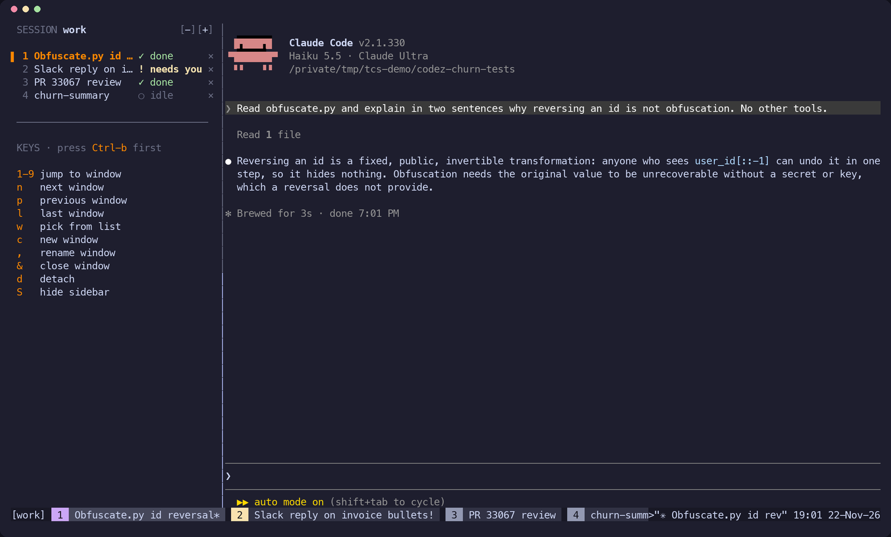

# tmux-claude-sidebar

A window list on the left of every tmux window, for running several Claude Code
sessions side by side (one tmux window per git worktree). Each row shows what
that session is doing, so you can see which one is waiting for you.



- **Status per window**: `working` after you send a prompt, `needs you` when
  Claude asks for permission or asks you a question, `done` when it finishes,
  `idle` when a session has started but has no prompt yet. Windows without
  Claude Code show no status.
- **Click a window row** to switch to it. **Click a key row** to do the same as
  typing `Ctrl-b` and that key. Clicking the sidebar never moves keyboard focus
  into it.
- **Click `×`** to close that window. tmux asks `(y/n)` first, then closes the
  window and stops everything running in it (Claude Code, the shell, and their
  child processes).
- **Width**: 36 columns by default. Click `[−]` or `[+]` at the top of the
  sidebar to make it 2 columns narrower or wider, or drag its right border.
  The new width applies to every window and is kept after tmux restarts
  (it is saved in `~/.tmux/claude-sidebar-width`).
- **`Ctrl-b S`** hides or shows the sidebar in every window of the session. New
  windows follow the current setting.
- **Window names** come from the title Claude Code gives its session, like
  Terminal tabs do. Until Claude sets a title, the window is named after its
  directory, with a leading `codez-` removed. `Ctrl-b ,` renames a window and
  the name then stays fixed.
- A permission prompt in a background window rings the terminal bell, so its
  tab in the status bar turns yellow with a `!`.

Every default tmux key still works. The only new key is `Ctrl-b S`.

## Install

Needs macOS or Linux, tmux 3.4 or newer, git, python3, and Claude Code.

```sh
git clone https://github.com/andrsnn/tmux-claude-sidebar.git
cd tmux-claude-sidebar
./install.sh
```

Then start tmux, or if it is already running, `install.sh` reloads it for you.
Restart any Claude Code sessions that were already running, so they load the
new hooks.

Running `./install.sh` again is safe; it replaces what it installed before.

### What install changes

- **Backups first**: `~/.tmux.conf` and `~/.claude/settings.json` are copied to
  `.bak-YYYYMMDD` (with a time added if that name is taken).
- **`~/.tmux/sidebar/`**: the scripts.
- **`~/.tmux/plugins/`**: [tmux-sensible](https://github.com/tmux-plugins/tmux-sensible)
  v3.0.0 and [catppuccin/tmux](https://github.com/catppuccin/tmux) v2.3.2,
  cloned with git and checked out at a fixed commit (no TPM). The commits are
  listed in `install.sh`.
- **`~/.tmux.conf`**: one block between `# >>> tmux-claude-sidebar >>>` and
  `# <<< tmux-claude-sidebar <<<`, at the top of the file so your own settings
  still win. It turns on `mouse`, `extended-keys` (Shift+Enter in Claude Code),
  `allow-passthrough`, and `base-index 1`. Lines of yours that would override
  the theme or the window names (`status-style`, `window-status-*-style/format`,
  `automatic-rename-format`, and `set -as terminal-features ...extkeys`, which
  the block already covers) are commented out with a `# [tmux-claude-sidebar]`
  prefix, and install lists them.
- **`~/.claude/settings.json`**: hooks that record each session's state on its
  tmux window, merged next to your existing hooks. They do nothing outside
  tmux and never fail. Also sets `preferredNotifChannel` to `terminal_bell`;
  your previous value is saved and put back by uninstall.

If `settings.json` is not valid JSON, or `~/.tmux.conf` has a start marker
without an end marker, install stops without changing either file. Symlinked
config files (stow and similar) are edited in place and stay symlinks.

### Mouse mode

The sidebar needs tmux mouse mode. With it on, a drag selects text in tmux,
or in Claude Code, which handles the mouse itself. To select text with your
terminal instead, hold Option in iTerm2, Fn in Terminal.app, or Shift in most
other terminals while dragging. In Terminal.app you can also turn off
View > Allow Mouse Reporting.

A drag with Ctrl or Option held does the same as a plain drag. tmux 3.8 would
otherwise open a new floating pane with a shell in it (Ctrl) or move the pane
(Option).

### Fonts

No Nerd Font needed. If you switch catppuccin to its icon styles, you will need
one.

## Uninstall

```sh
./uninstall.sh
```

Removes the block, the hooks and the scripts, turns your disabled lines back
on, restores your notification setting, and closes the sidebars in a running
tmux server. The plugins in `~/.tmux/plugins` are left in place.

## How it works

- Each window gets a 36-column pane on the left, marked with the pane option
  `@sidebar`. It runs `render.sh`, which redraws from `tmux list-windows` once
  a second.
- tmux hooks add the pane to new windows, keep it at the chosen width when the
  terminal resizes, move focus back to the main pane if you land on the
  sidebar, and close a window once only the sidebar is left in it.
- Claude Code hooks set the window option `@claude_state`:

  | Claude Code event | state |
  |---|---|
  | SessionStart | idle |
  | UserPromptSubmit | working |
  | PermissionRequest, Notification (permission_prompt, elicitation_dialog) | needs |
  | PostToolUse, PostToolUseFailure, PermissionDenied | working |
  | Stop, StopFailure | done |
  | SessionEnd | (cleared) |

## Known limits

- **Esc leaves "working" showing.** Claude Code runs no hook when you interrupt
  it with Esc, so the window shows `working` until your next prompt.
- **"needs you" lasts until the tool finishes.** After you approve a long
  command, the row says `needs you` until the command ends.
- **One status per window.** Two Claude sessions in one window share it.
- **Long names are cut** to 17 characters at the default width. Widen the
  sidebar with `[+]` to see more.
- Shift+Enter also needs your terminal to send it as a distinct key (most do,
  including iTerm2, Ghostty, kitty and WezTerm).

## Tests

```sh
python3 test/test_edit_configs.py          # config editing, in temp dirs
python3 test/acceptance.py                 # tmux behaviour on a separate server
python3 test/acceptance.py --claude        # plus live Claude Code checks (haiku)
```

The acceptance tests use their own tmux server (`tmux -L sidebar-test`) and
attach a real client through a pty, so keys, clicks and resizes go through
tmux the same way they do from a terminal.

## Plugin review

Both plugins were read in full at the pinned commits:

- No network calls (`curl`, `wget` or similar), no `eval` of fetched content,
  and no file writes; everything goes through `tmux` commands.
- tmux-sensible v3.0.0 sets options and adds `Ctrl-b R` (reload config),
  `Ctrl-b C-p` / `C-n` (previous/next window) only if those keys are unbound.
  It also tries the `utf8` options that tmux removed, which only print errors;
  the block hides them.
- catppuccin v2.3.2 runs shell commands only from status modules you would
  add yourself (`uptime`, `whoami`, `gitmux`). This setup adds none.

## License

MIT
